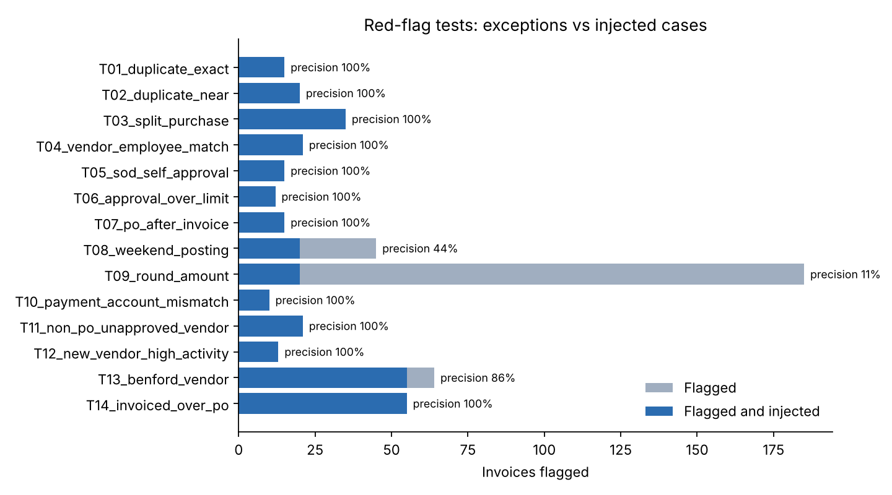

# AP Forensic Analytics: Red-Flag Testing and Anomaly Detection

Can rule-based tests and an unsupervised model find fraud and control failures in a year of accounts payable data, and which method finds what?

This project runs a forensic data analytics review on a synthetic procure-to-pay dataset (3,668 invoices, SGD 14.8M):

- **Data-quality checks** that must pass before anything else runs
- **14 red-flag tests** in SQL (DuckDB) and Python
- **Benford's law** first-digit testing
- An **Isolation Forest** anomaly model
- A **risk-ranked case list** and a **findings memo**

238 invoices are seeded with 11 known schemes, so every procedure can be scored for precision and recall.

➡️ **Read the findings:** [`reports/findings_memo.md`](reports/findings_memo.md)

## Headline results

- **227 invoices (6.2%) are recommended for review.** They contain 92% of the seeded cases, at 96% precision.
- **Control tests had 100% precision and recall** on their target schemes: duplicates, split purchases, vendor–employee matches, self-approval, approvals above limit, retrospective POs, diverted payments and over-billing.
- **Weak signals are noisy on their own.** Round sums were 11% precise and weekend postings 44%, because the data has legitimate retainers and a year-end close batch. They add to a case's score but don't open a case by themselves.
- **The Benford vendor test** isolated the one colluding vendor (chi-square 110, p < 0.001). The full population conforms (MAD 0.0087).
- **The Isolation Forest finds 66% seeded cases in its top 50**, about 10 times the 6.5% base rate, without seeing any rules or labels. It catches ghost vendors and duplicates but misses control breaches with normal-looking amounts. The model complements the rules; it doesn't replace them.



## How it works

```
fra/generate_data.py     synthetic employees, vendors, POs, invoices, payments
                         + 11 injected schemes logged to data/injected_anomalies.csv
sql/01_data_quality.sql  7 blocking + 4 warning checks (pipeline stops on a blocking failure)
sql/tests/T01–T14        rule-based red-flag tests, each returning invoice_id + reason
fra/benford.py           population MAD (Nigrini thresholds) + per-vendor chi-square (T13)
fra/pipeline.py          loads DuckDB, runs checks and tests -> outputs/exceptions.csv
fra/model.py             Isolation Forest on 9 behavioural features, risk score, case list
fra/evaluate.py          precision / recall per test, precision@k per ranking method
fra/charts.py            figures for the memo
tests/                   23 pytest tests
```

| Seeded scheme | Caught by |
|---|---|
| Exact / near-duplicate invoices | T01, T02, T14 |
| Split purchases under the approval limit | T03 |
| Ghost vendors (employee bank account / address) | T04, T11, T12 |
| Self-approval (segregation of duties) | T05 |
| Approval above delegated limit | T06 |
| Retrospective POs | T07 |
| Weekend postings | T08 |
| Round-sum over-billing | T09, T14 |
| Diverted payments | T10 |
| Fabricated amounts (colluding vendor) | T13 (Benford) |

Full logic, weights and legitimate explanations for each test: [`docs/test_catalogue.md`](docs/test_catalogue.md). Table definitions: [`docs/data_dictionary.md`](docs/data_dictionary.md).

## Run it

```bash
pip install -r requirements.txt
python -m fra.generate_data   # rebuild data/ (seed 42, deterministic)
python -m fra.pipeline        # data-quality checks + red-flag tests -> outputs/exceptions.csv
python -m fra.model           # Isolation Forest, case list, scorecard, metrics.json
python -m fra.charts          # reports/figures/
python -m pytest -q           # 23 tests
```

## Outputs

| File | Contents |
|---|---|
| `outputs/dq_results.csv` | Data-quality check results |
| `outputs/exceptions.csv` | One row per invoice × test hit, with the reason |
| `outputs/case_list.csv` | Every invoice with rule score, model score, risk score and priority (ready for Power BI / Tableau) |
| `outputs/test_scorecard.csv` | Precision and recall per test |
| `outputs/metrics.json` | Population metrics, precision@k by ranking method, model recall by scheme |
| `outputs/benford_*.csv` | Population digit table and vendor chi-square results |

## Limitations

The data is synthetic, and each scheme was built to break one control, so these recall figures are an upper bound. Thresholds are judgement calls to tune per client. Vendor–employee matching is exact, not fuzzy. In a real review, exceptions are leads to investigate with supporting documents, not conclusions.

## Tools

SQL (DuckDB) · Python (pandas, scikit-learn, SciPy, matplotlib) · pytest
