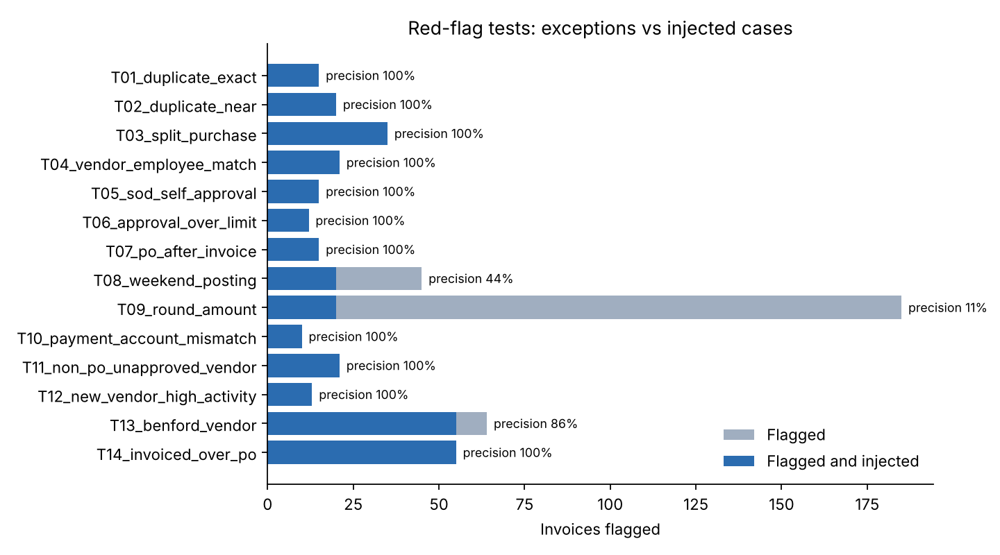
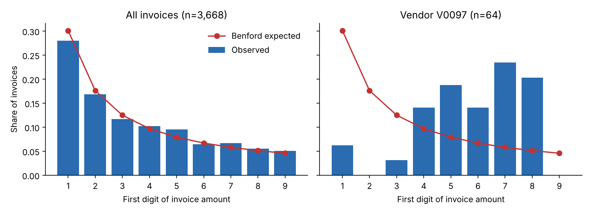
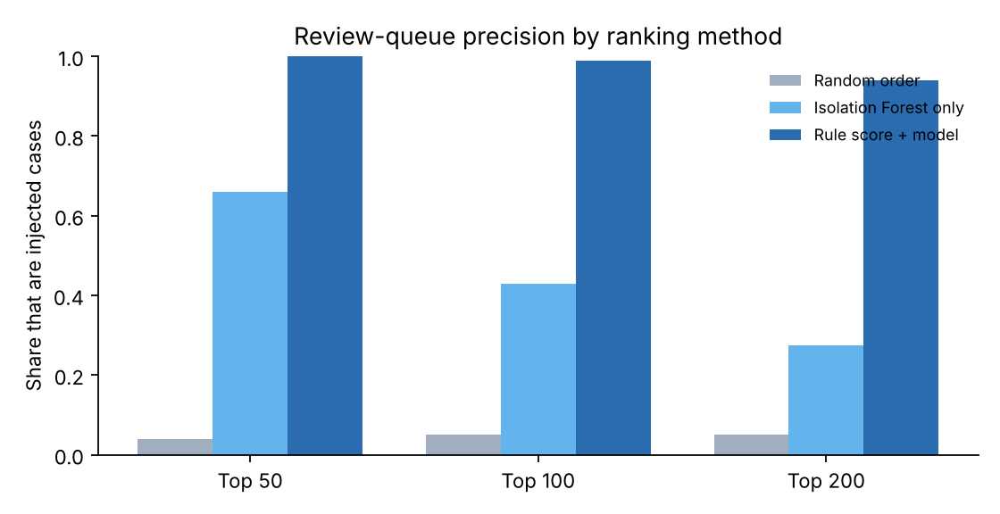

# Findings memo: accounts payable red-flag review, FY2025

**Scope.** 3,668 invoices (SGD 14.78M) from 249 vendors, with linked POs, payments, and the vendor and employee masters. All data is synthetic. 238 invoices were deliberately seeded with 11 fraud and control-failure schemes so that each procedure can be scored. In a real review, no answer key exists, and every exception below would be a lead to investigate, not a finding.

**Procedures.** 11 data-quality checks, 14 rule-based red-flag tests (13 in SQL, plus a Benford vendor test in Python), a population Benford test, and an Isolation Forest anomaly model. These combine into a risk-ranked case list (`outputs/case_list.csv`).

## Summary

- **All data-quality checks passed**, so the tests ran on complete and consistent data.
- **227 invoices (6.2% of the population, SGD 1.54M) are recommended for review**: 113 High priority and 114 Medium.
  - **218 of the 238 seeded cases (92%) are in this queue.** 96% of the queue are seeded cases.
  - The 20 seeded cases not in the queue are weekend postings. On their own they can't be told apart from the legitimate year-end close batch without the close calendar.
- Every seeded case is flagged by at least one test.
- Precision varies widely by test:
  - Control tests (duplicates, segregation of duties, approval limits, vendor–employee matches, payment-account mismatches, over-billing) were 100% precise.
  - Weak signals were noisy: round sums were 11% precise and weekend postings 44%. That is why they only add to a case's score instead of opening a case by themselves.

## Key findings (seeded schemes)

| Area | What the tests found | Invoices | SGD |
|---|---|---|---|
| Ghost vendors | 3 vendors created in 2025 carry an employee's bank account (one also has the employee's home address). They bill without POs | 21 | 109,819 |
| Split purchases | 12 groups where one requester raised 2–4 POs to one vendor within days. Each was just under the SGD 10,000 manager limit, so director approval was avoided | 35 | 327,308 |
| Fabricated amounts | Vendor V0097's first digits fail Benford's law (chi-square 110, p < 0.001): no amounts start with 1–3 | 55 (+9 genuine invoices from the same vendor) | 373,706 |
| Duplicate billing | 15 exact and 20 re-keyed duplicates (suffix added or dash removed to get past a duplicate check) | 35 | 232,903 |
| Over-billing | 20 extra round-sum invoices that pushed POs above their approved value | 20 | 114,000 |
| Approval control breaches | 12 approvals above the approver's limit; 15 self-approved purchases | 27 | 279,035 |
| Retrospective POs | POs raised 2–20 days after the invoice | 15 | 52,537 |
| Diverted payments | Payments to accounts not on the vendor master | 10 | 34,375 |

The full population conforms to Benford's law (MAD 0.0087, "acceptable conformity" under Nigrini's thresholds). The vendor-level test is what isolates V0097.

## What the anomaly model adds

- **The Isolation Forest works without rules or labels.** 66% of its top 50 invoices are seeded cases, against a 6.5% base rate (about 10 times better).
  - It finds every ghost-vendor and exact-duplicate invoice in its top 200.
  - It finds 75% of the over-limit approvals.
- **It misses control breaches that look normal on paper.** Self-approvals, retrospective POs, diverted payments and fabricated amounts all have ordinary amounts and timing. Only rules that encode the control can catch them.
- **About a third of its top 100 (32 invoices) are not flagged by any rule.** Mostly these are utility invoices without POs, or instalment invoices far from the vendor's usual amount.
- **Conclusion:** the model is useful for triage and as a second view of the population, but it can't replace control-based tests. Combined ranking (rule score first, model as tie-breaker) gives 100% precision in the top 50 and 94% in the top 200.

## Limitations

- **Synthetic data.** Each scheme was designed to break one control, so these recall figures are an upper bound. Real schemes are messier and are often designed to avoid known tests.
- **Fixed thresholds.** The 14-day duplicate window, the SGD 8,500 split band and the Benford p-value are judgement calls and should be tuned to the client's data and policies.
- **No client context.** Weekend postings need the close calendar, and payment-account mismatches need the vendor bank-change log, before they can be cleared or escalated.
- **Open-source vendor data.** Name, bank and address matching is exact. Real data would need fuzzy matching (e.g. normalised addresses, name similarity).

## Recommended next steps

1. Review High-priority cases first, starting with the three ghost vendors and the diverted payments (where money has left the business).
2. Get the close calendar and bank-change log to clear or escalate the weekend and account-mismatch exceptions.
3. Add fuzzy vendor–employee matching and an approval-chain check for related parties.
